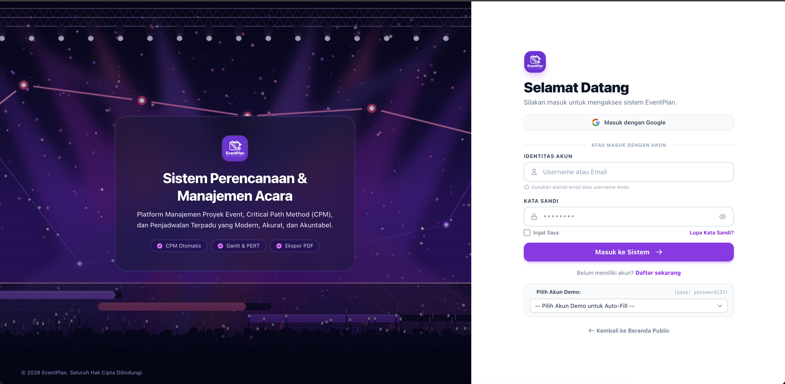
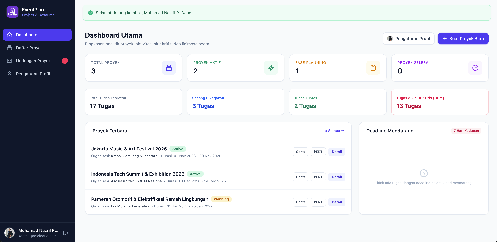
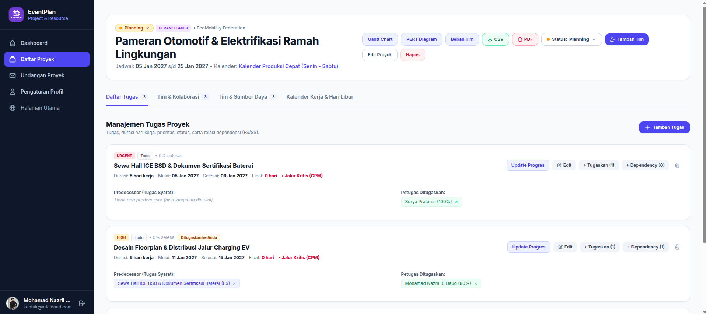
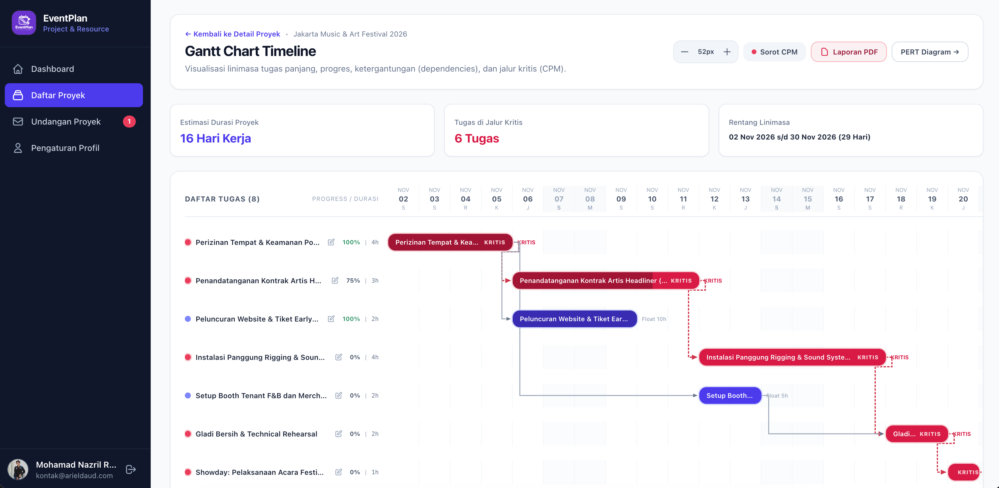
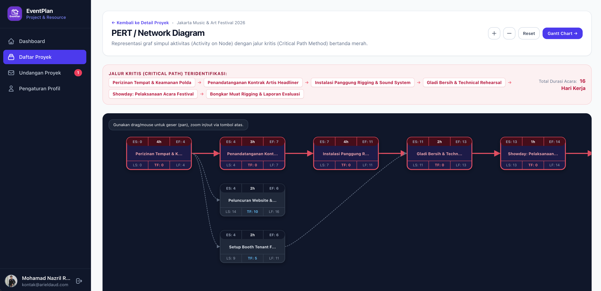
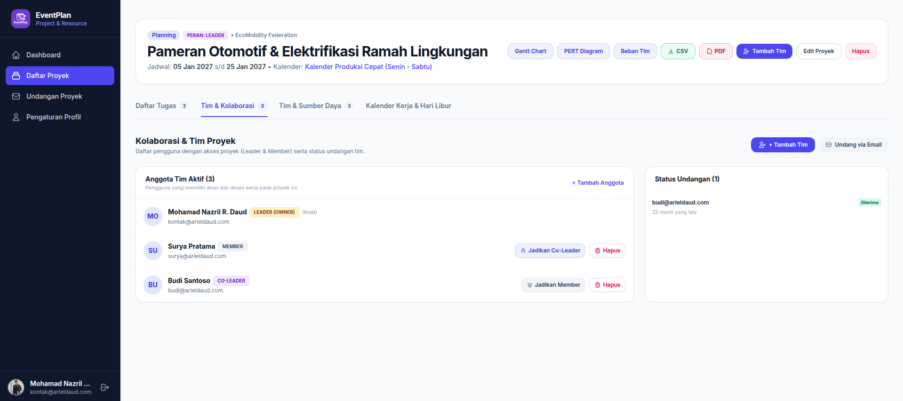
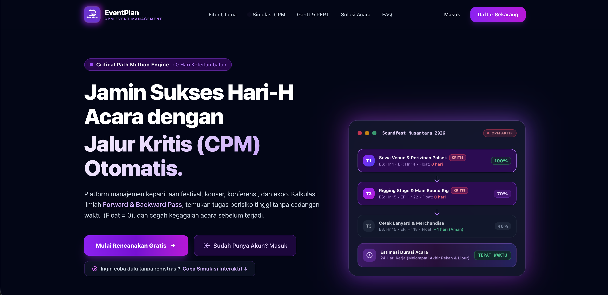
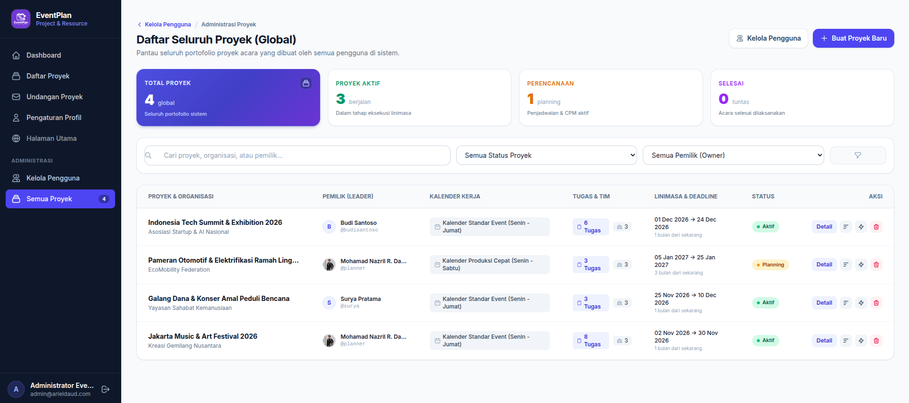
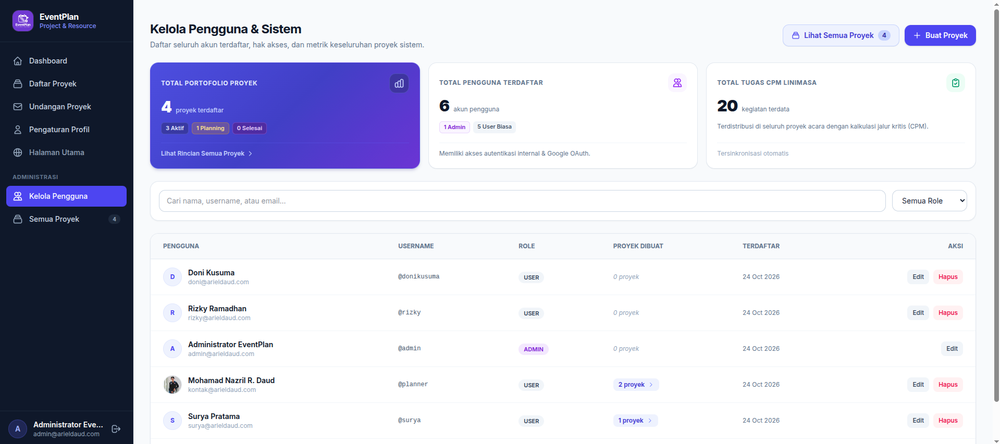

# EventPlan - Aplikasi Perencanaan & Manajemen Waktu Acara Berbasis Critical Path Method (CPM)

EventPlan adalah platform web modern untuk manajemen proyek dan perencanaan waktu acara (*Event Planning & Time Management*) yang mengimplementasikan algoritma **Critical Path Method (CPM)**, visualisasi interaktif **Gantt Chart**, **PERT / Network Diagram (Activity on Node)**, pemantauan kapasitas beban kerja tim (**Resource Workload & Over-allocation**), serta kolaborasi tim terintegrasi (**Team Collaboration & Role Management**).

Dibangun menggunakan stack teknologi mutakhir **Laravel 13**, **Tailwind CSS v4**, **Alpine.js**, dan basis data **MySQL**.

---

## 🌐 Demo Aplikasi Langsung (Live Demo)

Aplikasi telah terpasang dan dapat dicoba secara online melalui tautan berikut:
- **URL Demo**: [https://eventplan.arieldaud.com](https://eventplan.arieldaud.com)

> 💡 **Tips Pengujian Cepat:** Pada halaman masuk ([/login](https://eventplan.arieldaud.com/login)), Anda dapat menggunakan dropdown **"Pilih Akun Demo untuk Auto-Fill"** untuk masuk langsung tanpa perlu mengetik kata sandi secara manual. Sistem memiliki 2 peran utama (*System Role*), yaitu **Admin** dan **User**, di mana akun dengan peran **User** dapat memegang peran kolaborasi dinamis di dalam proyek sebagai **Leader** (pemilik/ketua proyek), **Co-Leader** (wakil ketua dengan hak kelola), maupun **Member** (anggota tim).

---

## 🌟 Fitur Utama

### 1. Autentikasi Fleksibel & Multi-Tenancy Proyek
- **Google OAuth Login**: Terintegrasi dengan Google OAuth via Laravel Socialite, dilengkapi fitur tautkan (*link*) dan lepas tautan (*unlink*) akun Google pada halaman Profil.
- **Penyimpanan Profil Persisten**: Pembaruan nama profil pengguna tetap terjaga dan tidak akan tertimpa saat login ulang menggunakan akun Google.
- **Tombol Dev / Local Login**: Opsi login cepat untuk pengujian lokal tanpa memerlukan kredensial Google asli.
- **Isolasi Akses Ketat (*ProjectPolicy*)**: Hanya pemilik proyek (*Owner*), pemimpin tim (*Leader/Co-Leader*), atau anggota tim berwenang yang dapat melihat dan memodifikasi data acara.

### 2. Kolaborasi Tim & Manajemen Peran Dinamis (Team Collaboration)
- **Deteksi Email Terdaftar Real-Time**: Input email pada modal penambahan tim memeriksa eksistensi akun secara asinkron (AJAX) dan menampilkan pratinjau avatar, nama lengkap, serta *username*.
- **Alur Undangan & Approval (*Pending Invitation Flow*)**: Undangan dikirim dengan status `pending` dan baru aktif menjadi anggota proyek setelah pengguna yang diundang menyetujuinya (*Approve*) melalui menu **Undangan Proyek** (`/invitations`).
- **Promosi & Demosi Peran (Member $\leftrightarrow$ Co-Leader)**:
  - Project Leader / Owner dapat mempromosikan **Member biasa menjadi Co-Leader** untuk memberikan hak pengelolaan tugas, linimasa, dan anggota.
  - Project Owner dapat menurunkan (*demote*) **Co-Leader kembali menjadi Member biasa** hanya dengan 1-klik yang aman disertai dialog konfirmasi.
  - Perlindungan hak akses: Peran Pemilik Proyek (*Owner*) dilindungi permanen dan tidak dapat diubah/diturunkan oleh siapapun.
  - Sinkronisasi otomatis peran tim dengan data *Resource* (sumber daya beban kerja & jadwal).
- **Keluarkan Anggota (*Remove Member*)**: Leader dan Owner dapat mengeluarkan anggota dari proyek secara aman.

### 3. Manajemen Proyek & Kalender Kerja Kustom
- **Kalender Kerja & Hari Libur**: Pengaturan hari kerja mingguan (default 5 hari kerja: Senin - Jumat) dan konfigurasi hari libur nasional atau cuti bersama.
- **Kalkulasi Hari Kerja Presisi**: Perhitungan otomatis durasi dan tanggal selesai (*end date*) tugas yang melompati akhir pekan dan hari libur secara akurat.
- **Penyaringan Otomatis (Auto-Filter)**: Pencarian dan filter status/peran proyek bekerja otomatis dengan *debounce timer* tanpa perlu menekan tombol submit secara manual.

### 4. Struktur Rincian Tugas & Ketergantungan (Task & Dependency Engine)
- **Manajemen Tugas**: Hierarki tugas proyek dengan rincian durasi kerja, tanggal mulai, penanggung jawab (*assigned resource*), prioritas (*Urgent*, *High*, *Medium*, *Low*), dan status progres (*Draft, In Progress, Completed*).
- **Tipe Ketergantungan Fleksibel**: Mendukung relasi **Finish-to-Start (FS)** dan **Start-to-Start (SS)** beserta pengaturan jeda waktu (*lag days*).
- **Deteksi Siklus Graf Ketergantungan (DAG Cycle Prevention)**: Algoritma validasi ketergantungan otomatis mencegah referensi melingkar (*circular dependency / deadlock*).

### 5. Kalkulasi Critical Path Method (CPM) Presisi Tinggi
- **Forward Pass**: Menghitung *Early Start* (ES) dan *Early Finish* (EF) untuk setiap tugas.
- **Backward Pass**: Menghitung *Late Start* (LS) dan *Late Finish* (LF) berdasarkan batas akhir proyek (*project deadline*).
- **Total Float & Free Float**: Mengidentifikasi kelonggaran waktu (*float*) per tugas. Tugas dengan *Total Float = 0* ditandai sebagai **Jalur Kritis (Critical Path)** yang menentukan durasi total keberhasilan acara.

### 6. Visualisasi Interaktif Proyek
- **Gantt Chart Timeline**: Linimasa horizontal dengan kontrol perbesaran hari (*dayWidth zoom*), progres tugas dinamis, panah relasi ketergantungan SVG, dan penyorotan warna merah khusus untuk tugas kritis.
- **PERT / Network Diagram (Activity on Node)**: Diagram graf alur kerja berbasis SVG interaktif dengan fitur geser (*pan*) dan perbesar/perkecil (*zoom*). Setiap simpul memuat nilai ES, EF, LS, LF, durasi, dan TF.
- **Resource Workload Matrix**: Matriks beban kerja harian tim, indikator kapasitas jam per hari, jadwal cuti, dan sistem peringatan kelebihan beban (*over-allocation* > 100%).

### 7. Laporan & Ekspor Lengkap (PDF & CSV)
- **Ekspor Dokumen PDF Resmi**: Menghasilkan dokumen laporan proyek profesional siap cetak yang memuat ringkasan eksekutif, linimasa proyek, daftar tugas kritis CPM, matriks anggota tim, dan kalender kerja.
- **Ekspor Data CSV Tersanitasi**: Ekspor data rincian tugas dan hasil kalkulasi CPM dengan proteksi *CSV Formula Injection Mitigation* (mencegah eksekusi ekspresi berbahaya pada aplikasi spreadsheet).

### 8. Administrasi Global (Khusus Administrator)
- **Kelola Pengguna Global (`/admin/users`)**: Pemantauan seluruh pengguna, penggantian peran sistem (*Admin / User*), reset avatar, dan penghapusan akun.
- **Portofolio Semua Proyek (`/admin/projects`)**: Panel kendali untuk meninjau seluruh proyek di sistem, statistik global, filter pemilik (*owner*), serta pembersihan proyek bermasalah.

---

## 📸 Tangkapan Layar Aplikasi (Screenshots)

### 1. Halaman Autentikasi Fleksibel (Google OAuth, Akun Biasa, Registrasi Manual & Akun Demo)
Antarmuka autentikasi modern dengan desain *split layout* responsif (*fixed viewport* 1 layar tanpa *scroll*). Menyediakan berbagai opsi akses yang lengkap dan fleksibel:
- **Google OAuth (Sign in with Google)**: Akses masuk instan dan aman 1-klik menggunakan akun Google dengan integrasi profil persisten.
- **Masuk Akun Biasa (Email / Username)**: Otentikasi standar menggunakan kombinasi email atau *username* terdaftar beserta kata sandi.
- **Pendaftaran Akun Baru (Registrasi Manual)**: Tersedia formulir pendaftaran mandiri bagi pengguna baru untuk membuat akun dengan verifikasi data yang aman.
- **Dropdown Pemilih Akun Demo (Auto-Fill)**: Opsi pengujian instan untuk masuk langsung menggunakan akun demo tanpa perlu mengetik kata sandi secara manual. Tersedia pilihan akun dengan peran sistem **Admin** (administrasi sistem global) serta peran **User** dengan berbagai peran tim dalam proyek (*Leader*, *Co-Leader*, dan *Member*).


---

### 2. Dashboard Analitik Utama (Project Overview)
Pusat kendali pengguna yang menyajikan kartu metrik global (Total Proyek, Proyek Aktif, Fase Planning, Proyek Selesai), status tugas (Total, Sedang Dikerjakan, Tuntas, dan Tugas Kritis CPM), daftar proyek terbaru, serta widget pengingat tenggat waktu (*Deadline 7 Hari Kedepan*).


---

### 3. Manajemen Rincian Proyek & Struktur Tugas
Tampilan detail manajemen proyek acara dengan tab navigasi lengkap (*Daftar Tugas, Kolaborasi Tim & Anggota, Tim & Sumber Daya, Kalender Kerja & Hari Libur*). Setiap tugas memuat indikator prioritas (*Urgent/High*), durasi hari kerja, relasi *predecessor*, petugas yang dialokasikan, badge penanda jalur kritis otomatis, serta tombol pengubah status proyek instan.


---

### 4. Visualisasi Linimasa Interaktif (Gantt Chart Timeline)
Linimasa Gantt horizontal dengan kontrol zoom lebar hari (*dayWidth*), bar progres dinamis, garis penghubung panah ketergantungan tugas (*SVG dependency connectors*), serta *highlight* merah khusus untuk tugas yang berada pada jalur kritis (CPM).


---

### 5. Diagram Jaringan Aktivitas (PERT / Network Diagram)
Representasi graf simpul *Activity on Node* (AoN) interaktif yang dilengkapi fitur *pan* & *zoom*. Menampilkan rincian *Early Start* (ES), *Early Finish* (EF), *Late Start* (LS), *Late Finish* (LF), durasi, dan *Total Float* (TF) dengan panah merah menyala yang menandai urutan rantai kritis penentu durasi total acara.


---

### 6. Kolaborasi Tim & Modal Undangan (Team Collaboration & Invite)
Modal penambahan anggota tim kolaborasi yang dilengkapi verifikasi email terdaftar secara real-time (*AJAX detection*), pratinjau kartu profil pengguna terdaftar (avatar, nama, username), opsi pemilihan peran (*Member* atau *Co-Leader*), dan pesan pengantar sebelum undangan dikirimkan untuk proses persetujuan (*approval*).


---

### 7. Halaman Utama & Simulator CPM Interaktif (Landing Page)
Halaman depan modern bernuansa *dark mode* futuristik yang dilengkapi simulator interaktif perhitungan jalur kritis (CPM), linimasa tugas animasi, dan ringkasan fitur utama sistem tanpa perlu registrasi terlebih dahulu.


---

### 8. Panel Administrasi Sistem Global (Kelola Proyek & Pengguna)
Modul manajemen terpusat khusus bagi **Administrator** untuk mengontrol ekosistem EventPlan secara menyeluruh:

- **Manajemen Seluruh Proyek Global (`/admin/projects`)**:
  Menyajikan metrik agregat seluruh proyek (Total Portofolio, Proyek Aktif, Perencanaan, dan Selesai), filter pencarian otomatis berbasis teks (*live search debounce*), penyaringan status acara, penelusuran pemilik (*owner filter*), pemantauan tanggal linimasa, serta opsi pembersihan (*delete*) proyek secara aman.
  

- **Manajemen Pengguna & Hak Akses Global (`/admin/users`)**:
  Panel komprehensif untuk mengelola akun pengguna terdaftar dengan metrik jumlah pengguna & tugas CPM terdata, pencarian cepat nama/username/email, filter peran sistem (*Admin* vs *User*), tautan pintas portofolio per pemilik, pembaruan data pengguna, serta kontrol penghapusan akun.
  

---

## 🚀 Kebutuhan Sistem & Dependensi

- **PHP**: `>= 8.2` (Disarankan PHP 8.2, 8.3, atau 8.4 dengan ekstensi `pdo_mysql`, `mbstring`, `openssl`, `bcmath`, `xml`, `gd`)
- **Composer**: `>= 2.2`
- **Node.js**: `>= 20.x` & **npm**
- **Basis Data**: MySQL `>= 8.0` atau MariaDB `>= 10.5`
- **Web Server**: Apache / Nginx dengan modul `mod_rewrite` aktif

---

## 🛠️ Panduan Instalasi & Menjalankan Aplikasi

### 1. Kloning Repositori & Install Dependensi PHP
```bash
git clone https://github.com/arieldauddotcom/EventPlan.git
cd EventPlan

# Install seluruh dependensi PHP via Composer
composer install
```

### 2. Konfigurasi Lingkungan (.env)
Salin berkas konfigurasi template `.env.example` ke `.env`:
```bash
cp .env.example .env
php artisan key:generate
```

Sesuaikan konfigurasi koneksi basis data pada berkas `.env`:
```env
DB_CONNECTION=mysql
DB_HOST=127.0.0.1
DB_PORT=3306
DB_DATABASE=eventplan_db
DB_USERNAME=root
DB_PASSWORD=
```

Buat database MySQL jika belum tersedia:
```bash
mysql -u root -e "CREATE DATABASE IF NOT EXISTS eventplan_db CHARACTER SET utf8mb4 COLLATE utf8mb4_unicode_ci;"
```

### 3. Jalankan Migrasi & Seeder Basis Data
Jalankan migrasi tabel beserta *seeder* data demo awal:
```bash
php artisan migrate --seed
```

### 4. Kompilasi Aset Frontend (Tailwind CSS v4 & Alpine.js)
```bash
npm install
npm run build
```

Untuk mode pengembangan frontend dengan *hot-reload*:
```bash
npm run dev
```

### 5. Buat Symlink Storage Publik
Pastikan folder storage publik tertaut:
```bash
php artisan storage:link
```

### 6. Menjalankan Server Lokal Laravel
```bash
php artisan serve
```
Buka browser pada alamat: `http://127.0.0.1:8000`.

---

## 🔑 Akun Demo Pengujian

Sistem autentikasi aplikasi memiliki **2 peran utama tingkat sistem (*System Role*)**, yaitu **`admin`** dan **`user`**:
- **Admin**: Memiliki akses ke modul administrasi global (`/admin/projects` dan `/admin/users`) untuk memantau seluruh portofolio proyek dan akun pengguna di sistem.
- **User**: Pengguna operasional yang dalam setiap proyek acara dapat memegang peran kolaborasi tim dinamis sebagai **`Leader`** (pemilik/ketua proyek), **`Co-Leader`** (wakil ketua dengan hak kelola), maupun **`Member`** (anggota tim).

Semua akun demo di bawah ini siap digunakan dengan kata sandi default: **`password123`**

| Nama Pengguna | Username | Alamat Email | Peran Sistem (*System Role*) | Peran Tim dalam Proyek Acara |
| :--- | :--- | :--- | :--- | :--- |
| **Administrator EventPlan** | `admin` | `admin@arieldaud.com` | `admin` | Administrator Sistem Global (Panel `/admin`) |
| **Mohamad Nazril R. Daud** | `planner` | `kontak@arieldaud.com` | `user` | **Leader** (Pemilik Proyek Konser Musik & Festival Seni) |
| **Surya Pratama** | `surya` | `surya@arieldaud.com` | `user` | **Co-Leader / Member** (Wakil Ketua & Leader Proyek Amal) |
| **Budi Santoso** | `budisantoso` | `budi@arieldaud.com` | `user` | **Leader / Member** (Ketua Tech Expo & Logistik) |
| **Doni Kusuma** | `donikusuma` | `doni@arieldaud.com` | `user` | **Member** (Anggota Tim Desain & Kreatif Panggung) |
| **Rizky Ramadhan** | `rizky` | `rizky@arieldaud.com` | `user` | **Member** (Anggota Tim Publikasi & Kemitraan) |

> 💡 *Catatan:* Seluruh kredensial di atas dapat dipilih secara otomatis melalui fitur **"Pilih Akun Demo untuk Auto-Fill"** pada halaman login.

---

## 🧪 Pengujian Otomatis & Audit Kualitas (Testing & Audit)

Aplikasi telah dilengkapi serangkaian pengujian unit (*Unit Tests*), pengujian fitur (*Feature Tests*), dan audit alur transaksi:

```bash
# Menjalankan pengujian Laravel PHPUnit / Pest
php artisan test
```

### Cakupan Pengujian:
1. **CriticalPathCalculatorTest**: Validasi kalkulasi forward pass, backward pass, total float, dan deteksi critical path secara matematis.
2. **WorkingDaysCalculatorTest**: Validasi pemotongan hari kerja, libur nasional, dan akhir pekan.
3. **DependencyValidatorTest**: Validasi siklus ketergantungan graf (*Cycle Detection*) untuk mencegah *deadlock*.
4. **TeamCollaborationTest**: Pengujian verifikasi email AJAX, pengiriman undangan pending, approval di `/invitations`, promosi Member ke Co-Leader, demosi Co-Leader, dan proteksi role Owner.
5. **VisualizationTest**: Validasi render dan responsivitas view Gantt Chart, PERT Network Diagram, dan Resource Workload Heatmap.
6. **ExportIntegrityTest**: Pengujian generasi file PDF via Dompdf dan sanitasi formula injection pada ekspor CSV.
7. **AuthAndSecurityTest**: Validasi proteksi rute, otentikasi Google OAuth, dan isolasi akses data antar-pengguna.

---

## 📂 Struktur Modul & Layanan Utama

```text
app/
├── Http/
│   ├── Controllers/
│   │   ├── AuthController.php               # Login, register, dev login, Google OAuth link/unlink
│   │   ├── DashboardController.php          # Metrik analitik & widget deadline
│   │   ├── ProjectController.php            # CRUD proyek & kalender kerja
│   │   ├── ProjectMemberController.php      # Verifikasi email AJAX, invite, promote/demote role
│   │   ├── ProjectInvitationController.php  # Manajemen undangan proyek (pending, accept, decline)
│   │   ├── TaskController.php               # Manajemen tugas & relasi dependensi (FS/SS)
│   │   ├── ResourceController.php           # Manajemen sumber daya & cuti kerja
│   │   ├── VisualizationController.php      # Controller Gantt, PERT, dan Resource Heatmap
│   │   ├── ExportController.php             # Ekspor PDF & CSV tersanitasi
│   │   └── AdminUserController.php          # Administrasi pengguna & seluruh proyek global
│   └── Middleware/
│       └── EnsureUserIsAdmin.php            # Proteksi akses khusus administrator
├── Models/
│   ├── Project.php                          # Model proyek, relasi CPM, dan helper isLeader/isMember
│   ├── ProjectMember.php                    # Model anggota tim & helper role label
│   ├── ProjectInvitation.php                # Model undangan pending/accepted/declined
│   ├── Task.php                             # Model tugas, status, prioritas & CPM values
│   ├── TaskDependency.php                   # Model relasi ketergantungan (FS/SS, lag days)
│   ├── Resource.php                         # Model sumber daya & tarif honor
│   └── WorkCalendar.php                     # Model kalender kerja & hari libur
└── Services/
    ├── CriticalPathCalculator.php           # Algoritma perhitungan CPM (Forward/Backward Pass)
    ├── WorkingDaysCalculator.php            # Layanan kalkulasi hari & jam kerja efektif
    └── DependencyValidator.php              # Validator deteksi siklus graf ketergantungan (DAG)
```

---

## TUGAS MATA KULIAH ARSITEKTUR SISTEM INFORMASI 
Implementasi Aplikasi Sistem Informasi Berbasis Agentic AI (Freebuff CLI)

NAMA : MOHAMAD NAZRIL R. DAUD

NIM : 531424083

Kelas : D

Semester : 5

Dosen Pengampu : Dr. Mohamad Syafri Tuloli, ST, MT

